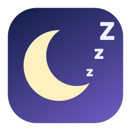

# Sleep Mac

A tiny menu bar app that puts your Mac to sleep **for real**: it first stops everything that would keep it awake, then sleeps.



## Menu

| Item | What it does |
| --- | --- |
| **Custom Commands…** | Opens the list of commands that run before sleep. Default commands are locked; add your own with **+**, remove one with **−** (asks for confirmation). |
| **Sleep** | Runs all commands in order, checks that nothing still holds a sleep assertion, then sleeps. |
| **Launch at Login** | Click once to check it (Sleep Mac starts when you log in), click again to uncheck it. If macOS asks for approval, the app opens System Settings → General → Login Items for you. |
| **Quit Sleep Mac** | Quits the app. |

## What Sleep does

1. Quits the iOS Simulator app and shuts down all simulators (a booted simulator keeps the Mac awake through its audio device).
2. Stops command-line tools that hold a sleep assertion, such as `caffeinate`. Apps and macOS services are never touched.
3. Turns `pmset disablesleep` back off if it was left on (asks for your admin password only when needed).
4. Runs your custom commands.
5. Re-checks. If something is still keeping the Mac awake it tells you and lets you choose **Sleep Anyway** or **Cancel**.
6. Runs `pmset sleepnow`.

Custom commands are plain shell commands run with `/bin/zsh -c`. Tick *Run as administrator* to run one as root through the standard macOS password dialog.

## Install

Open `dist/Sleep-Mac.dmg` and drag **Sleep Mac** to Applications. The app is signed ad hoc, so on a different Mac use right-click → Open the first time.

Install it in Applications **before** switching on *Launch at Login*: macOS remembers the app's location, so a copy running from `dist/` (which every build deletes) would leave a dead login item.

## Build from source

Requires Xcode 15+ command line tools.

```bash
scripts/build_app.sh     # tests, universal release build, Sleep Mac.app, zip and dmg in dist/
swift test               # unit tests only
```

Developer flags (safe to run, they change nothing on your system):

```bash
.build/debug/SleepMac --dry-run                 # print what Sleep would do
.build/debug/SleepMac --ui-smoke-test /tmp/ui   # headless UI checks and PNG snapshots
```

Your custom commands are stored in `~/Library/Application Support/Sleep Mac/commands.json`.
